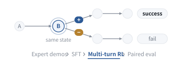

<picture>
  <source media="(prefers-color-scheme: dark)" srcset="assets/banner-dark.svg">
  
</picture>

**Open to LLM algorithm internships** — available now, 5+ days a week, for 9 consecutive months. 
[Homepage](https://hey-chillax.github.io) · [Google Scholar](https://scholar.google.com/citations?user=SpbemaUAAAAJ) · [CV (PDF, in Chinese)](https://hey-chillax.github.io/files/Yi_Zhang_CV_zh.pdf) · [yizhang@smail.nju.edu.cn](mailto:yizhang@smail.nju.edu.cn)

<table>
<tr>
<td width="50%" valign="top">

<a href="https://hey-chillax.github.io/projects/scaffold-opd.html"><picture><source media="(prefers-color-scheme: dark)" srcset="assets/card-opd-dark.svg"></picture></a>

**[Scaffold-OPD](https://github.com/Hey-Chillax/scaffold-opd)** · SFT → OPD → RL

A Qwen3-4B teacher steps into the Qwen3-1.7B student's rollout only where it misses a reflection, then the whole answer is distilled token by token. MATH-500 + AIME 2024–26 average **25.4 → 46.9** in 40 steps, **+6.2** over standard OPD.

[Report](https://hey-chillax.github.io/projects/scaffold-opd.html) · [Code](https://github.com/Hey-Chillax/scaffold-opd)

</td>
<td width="50%" valign="top">

<a href="https://hey-chillax.github.io/projects/stepcredit-rl.html"><picture><source media="(prefers-color-scheme: dark)" srcset="assets/card-scr-dark.svg"></picture></a>

**[StepCredit-RL](https://github.com/Hey-Chillax/stepcredit-rl)** · SFT → agentic RL

Multi-turn tool-calling agents (Qwen3-4B) that get credit for each step, not just the final outcome. ALFWorld **98.6% / 94.0%** (seen / unseen) after SFT and RL; **82.9% vs 70.7%** over GRPO from the base model.

[Report](https://hey-chillax.github.io/projects/stepcredit-rl.html) · [Code](https://github.com/Hey-Chillax/stepcredit-rl)

</td>
</tr>
</table>

All results are single-seed.

**Focus** · post-training (SFT, RL, on-policy distillation) · agentic RL and credit assignment · efficient long-video understanding 
**Publications** · four SCI journal papers and one EI conference paper as first author, from undergraduate research on strong-field laser physics 
**Also** · [openreview-paper-digest](https://github.com/Hey-Chillax/openreview-paper-digest) filters OpenReview papers by keywords and review scores, then reads each one with an LLM 
**Tools** · PyTorch · FSDP2 · veRL · vLLM · Slurm, 16,000+ H100 GPU-hours
